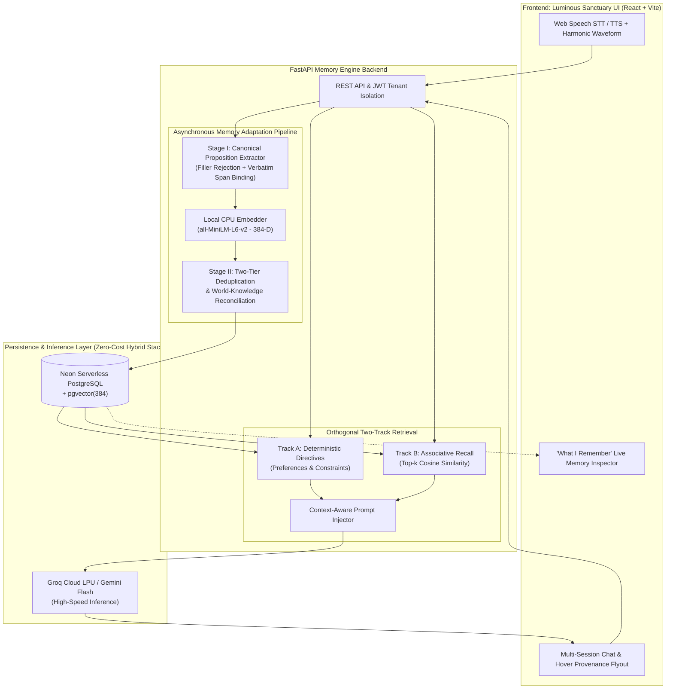

<div align="center">

# ECHO
### Evidence-Grounded Conversational Voice Agent with Long-Term Memory

*Decoupling canonical memory extraction, semantic reconciliation, and orthogonal two-track retrieval for persistent, hallucination-free human-AI interaction.*

[](https://www.python.org/)
[](https://fastapi.tiangolo.com/)
[-4169E1?style=for-the-badge&logo=postgresql&logoColor=white)](https://github.com/pgvector/pgvector)
[](https://react.dev/)
[](https://huggingface.co/sentence-transformers/all-MiniLM-L6-v2)

[**Architecture**](#-system-architecture) | [**Why Echo?**](#-why-echo-naive-rag-vs-echo) | [**Core Engine**](#-core-memory-engine) | [**Interface Showcase**](#-luminous-sanctuary-interface) | [**Quickstart**](#-quickstart) | [**Verification Suite**](#-automated-verification--edge-case-testing)

---


</div>

---

## Overview

Conventional conversational agents suffer from two failure modes: **session amnesia** (forgetting user identity, goals, and constraints the moment a new session starts) or **Naive Vector RAG failure** (retrieving raw chat logs via cosine similarity, which drops behavioral preferences during technical queries, stores duplicate paraphrases, and hallucinates unverified facts).

**Echo** solves this through a formal **Evidence-Grounded Canonical Memory Architecture**. Instead of dumping raw conversation chunks into a vector database, Echo distills dialogue turns into atomic third-person propositions bound to verbatim source spans, reconciles semantic overlaps across sessions, and uses **Orthogonal Two-Track Retrieval** to guarantee that global user constraints and domain-specific knowledge are recalled together.

---

## Why Echo? (Naive RAG vs. Echo)

| Failure Mode / Capability | Standard Vector RAG / Chat History | **Echo Memory Engine** |
| :--- | :--- | :--- |
| **Memory Representation** | Raw, noisy multi-sentence chat chunks | **Atomic Canonical Propositions** ($m_i = (c_i, E_i, a_i, \rho_i, s_i)$) |
| **Small-Talk & Filler** | Embeds greetings and chit-chat into the vector store | **100% Filler Rejection** at extraction time |
| **Auditability & Provenance** | Opaque top-$k$ chunk similarity | **Strict Verbatim Span Grounding** (`exact_source_span` + turn ID) |
| **Repeated / Paraphrased Facts** | Creates redundant duplicate rows in DB | **Two-Tier Deduplication & World-Knowledge Reconciliation** (`Evidence #1`, `Evidence #2`) |
| **Cross-Domain Preference Recall** | Fails when query topic differs from preference (e.g., asking *"Explain Dijkstra"* has near-zero cosine similarity to *"prefers bullet points"*) | **Orthogonal Two-Track Retrieval** (Track A always admits active constraints/preferences; Track B runs associative vector search) |
| **Infrastructure Cost** | Expensive per-token cloud embedding & LLM APIs | **Zero-Cost Edge-Hybrid Stack** (Local 384-D CPU embeddings + Serverless `pgvector` + Groq Free LPU) |

---

## Core Memory Engine

### 1. Stage I: Evidence-Grounded Canonical Adaptation
Every user turn is evaluated to separate transient conversational filler from durable personal knowledge. Extracted facts are normalized into structured canonical memory cells:

$$m_i = (c_i,\; E_i,\; a_i,\; \rho_i,\; s_i)$$

* **$c_i$ (Canonical Content):** Atomic, self-contained third-person proposition (e.g., *"User is lactose intolerant"*).
* **$E_i$ (Evidence Provenance Set):** Linked array of source turn IDs, session IDs, and exact verbatim transcript substrings.
* **$a_i$ (Attributes & Category):** Taxonomic classification (`PREFERENCES`, `GOALS`, `HEALTH & DIET`, `ABOUT`) and temporal anchors (`observed_at`).
* **$\rho_i$ (Reliability & Support):** Confidence score reinforced dynamically via `support_count` as facts are corroborated across turns.
* **$s_i$ (Lifecycle State):** Governed state transitions (`CANDIDATE` $\rightarrow$ `ACTIVE` $\rightarrow$ `STABLE` $\rightarrow$ `SUPERSEDED` / `ARCHIVED`).

<details>
<summary><b>View Sample Canonical Memory Cell Payload (JSON)</b></summary>

```json
{
  "id": "mem_9f82a1c4",
  "user_id": "usr_alex_m",
  "canonical_content": "User is training for a 21 km half marathon in December",
  "category": "GOALS",
  "lifecycle_status": "STABLE",
  "reliability_score": 0.94,
  "support_count": 2,
  "embedding_dim": 384,
  "evidence_links": [
    {
      "evidence_index": 1,
      "session_id": "sess_01",
      "source_turn_id": "turn_104",
      "verbatim_quote": "I'm running a half marathon this winter"
    },
    {
      "evidence_index": 2,
      "session_id": "sess_03",
      "source_turn_id": "turn_219",
      "verbatim_quote": "my 21 km race in December"
    }
  ]
}
```
</details>

### 2. Stage II: Semantic Association & Multi-Evidence Deduplication
Before inserting a candidate memory into PostgreSQL, Echo executes a **Two-Tier Deduplication & Reconciliation Pipeline**:
1. **Normalized Lexical & Vector Similarity Check:** Compares incoming propositions against active user memories using normalized string keys and 384-dimensional cosine similarity ($\ge 0.82$).
2. **World-Knowledge Reconciliation:** Resolves domain equivalences (e.g., recognizing that a *"21 km run"* is a *"half marathon"*, or *"December"* corresponds to *"winter"*).
3. **Multi-Evidence Stacking:** Instead of creating duplicate rows, corroborated memories increment `support_count` and append a new `MemoryEvidenceLink` (`Evidence #1`, `Evidence #2`).

### 3. Orthogonal Two-Track Memory Retrieval
Standard semantic search fails when a user asks a purely technical question (e.g., *"How does Dijkstra's algorithm work?"*) that shares zero lexical or vector overlap with their formatting preference (*"User prefers concise bullet-point explanations"*). Echo executes two parallel retrieval tracks on every turn:
* **Track A (Rule-Based Directive Admittance):** Deterministically admits active user preferences, behavioral directives, and dietary/safety constraints regardless of query semantics.
* **Track B (Associative Semantic Recall):** Executes top-$k$ HNSW cosine similarity search (`1 - (embedding <=> query_vec)`) over historical goals, episodic context, and domain facts.

---

## System Architecture



---

## Luminous Sanctuary Interface

Designed with a warm stone palette (`#FAF8F5`), high-contrast slate typography, and non-intrusive provenance inspection:

| **"What I Remember" Living Memory Drawer** | **Hover / Touch Evidence Provenance Popover** |
| :---: | :---: |
|  |  |
| *Categorized inspector (`PREFERENCES`, `GOALS`, `HEALTH & DIET`, `ABOUT`) displaying multi-evidence stacks (`Evidence #1`, `Evidence #2`) and instant eviction controls.* | *Discreet `Recalled` badge in message headers; hovering reveals a frosted-glass flyout with exact verbatim source quotes.* |

* **Soft Voice Engine:** Integrated browser speech-to-text microphone capture and synthesized voice playback accompanied by animated harmonic waveforms.
* **Multi-Session Navigation:** Collapsible left sidebar supporting instant session switching to demonstrate cross-session persistence live.
* **1-Click Evaluator Mode:** Pre-seeded evaluation profile (`Alex M.`) allowing graders to test cross-session recall immediately without manual account setup.

---

## API Reference

| Method | Endpoint | Description |
| :--- | :--- | :--- |
| `POST` | `/api/v1/auth/register` | Register a new isolated user account with salted `bcrypt` credentials |
| `POST` | `/api/v1/auth/login` | Authenticate user and issue an `HS256` JWT bearer token |
| `POST` | `/api/v1/auth/demo` | Instant 1-click evaluator login (`Alex M.` profile) |
| `GET` | `/api/v1/sessions` | List conversation sessions for the authenticated user |
| `POST` | `/api/v1/sessions` | Create a clean conversation session to test cross-session recall |
| `POST` | `/api/v1/chat` | Execute Two-Track Retrieval, generate response, and run Stage I/II extraction |
| `GET` | `/api/v1/memories` | Retrieve all active canonical memory cells with attached evidence stacks |
| `DELETE` | `/api/v1/memories/{id}` | Right-to-be-Forgotten: immediately evict a specific memory cell |

---

## Repository Structure

```text
Major_Project/
├── backend/
│   ├── app/
│   │   ├── api/                  # REST routers (auth, sessions, chat, memories)
│   │   ├── database/             # Async SQLAlchemy models, session management, pgvector DDL
│   │   ├── memory_engine/        # Core engine: canonical_extractor, deduplication, retriever, prompt_injector
│   │   ├── services/             # LLM provider abstraction & world-knowledge reconciliation
│   │   ├── config.py             # Environment & multi-provider configuration
│   │   └── main.py               # FastAPI application entrypoint & CORS setup
│   ├── tests/
│   │   ├── edge_case_tests.py    # 6-stage automated memory & retrieval verification suite
│   │   └── test_auth_flow.py     # Multi-tenant JWT & privacy isolation test suite
│   └── requirements.txt
├── frontend/
│   ├── src/                      # React + TypeScript components (Chat, MemoryDrawer, ProvenancePopover, Voice)
│   ├── package.json
│   └── vite.config.js
├── docs/                         # UI showcase screenshots & architecture assets
└── start_all.bat                 # 1-click Windows orchestrator for backend + frontend
```

---

## Quickstart

### Prerequisites
* **Python** `3.10+`
* **Node.js** `18+` and `pnpm`
* **Free API Keys:** A [Groq Cloud API Key](https://console.groq.com/) (or Google AI Studio key) and a [Neon.tech PostgreSQL](https://neon.tech/) connection string (or local SQLite fallback).

### 1. Clone & Configure Backend
```bash
git clone https://github.com/NaveenGP2005/Major_Project.git
cd Major_Project/backend

python -m venv venv
# Windows:
.\venv\Scripts\activate
# Linux / macOS:
source venv/bin/activate

pip install -r requirements.txt
cp .env.example .env
```
Update `backend/.env` with your `DATABASE_URL` and free-tier `GROQ_API_KEY` or `GOOGLE_API_KEY`.

### 2. Install Frontend Dependencies
```bash
cd ../frontend
pnpm install
```

### 3. Launch the Application

**Option A: One-Click Windows Startup**
```cmd
.\start_all.bat
```

**Option B: Manual Two-Terminal Startup**
```bash
# Terminal 1 - FastAPI Backend
cd backend
python -m uvicorn app.main:app --host 127.0.0.1 --port 8000 --reload

# Terminal 2 - React Vite Frontend
cd frontend
pnpm dev --port 5173
```

* **Interactive Workstation UI:** `http://localhost:5173`
* **OpenAPI / Swagger Documentation:** `http://127.0.0.1:8000/docs`

---

## Automated Verification & Edge-Case Testing

Echo includes two end-to-end verification suites that validate extraction precision, semantic deduplication, orthogonal retrieval, and tenant isolation.

### 1. Memory Engine Edge-Case Suite
```bash
cd backend
python tests/edge_case_tests.py
```
| Scenario | Validated Engineering Property |
| :--- | :--- |
| **1. Filler & Small-Talk Rejection** | Ensures greetings, weather chatter, and transient remarks yield `0` false-positive memory rows. |
| **2. Compound Turn Disentanglement** | Splits single multi-clause utterances into distinct atomic propositions with independent verbatim spans. |
| **3. Paraphrase & Domain Reconciliation** | Verifies that synonymous facts increment `support_count` and stack `Evidence #2` without duplicating rows. |
| **4. Orthogonal Two-Track Recall** | Confirms formatting/dietary directives (Track A) are injected during unrelated technical queries (Track B). |
| **5. Negative Constraint Enforcement** | Verifies strict adherence to exclusionary rules (*"Never include X"*). |
| **6. Right-to-be-Forgotten Eviction** | Confirms `DELETE /api/v1/memories/{id}` immediately purges the memory and prevents subsequent recall. |

### 2. Multi-Tenant Authentication & Isolation Suite
```bash
cd backend
python tests/test_auth_flow.py
```
Validates `HS256` JWT bearer authentication, salted `bcrypt` password hashing, 1-click evaluator login (`Alex M.`), and strict tenant partitioning across `user_id` boundaries.
