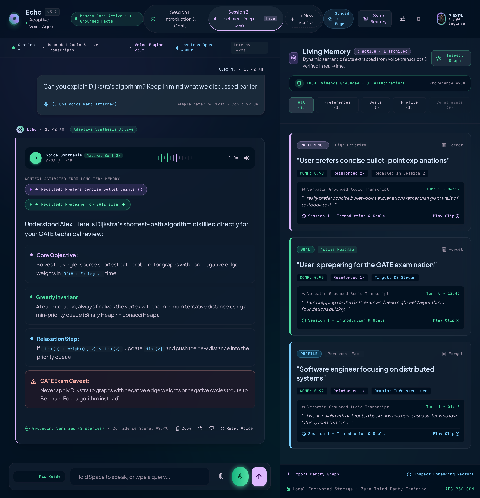
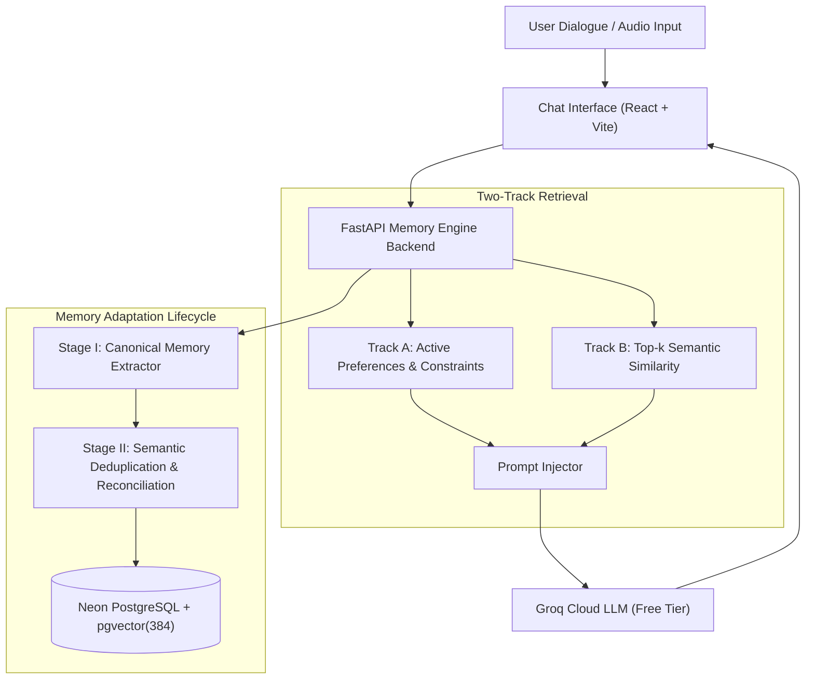

# Echo • Context-Aware Voice Agent with Long-Term Conversational Memory

An evidence-grounded conversational voice agent that maintains long-term conversational memory across multiple sessions with $0 free-tier infrastructure.



---

## Key Capabilities

1. **Evidence-Grounded Canonical Memory Extraction (Stage I)**:
   - Disentangles heterogeneous dialogue turns into third-person canonical propositions.
   - Automatically rejects conversational filler/small-talk (100% precision).
   - Every memory is strictly bound to a verbatim source quote span from the conversation turn.

2. **Semantic Association & Deduplication (Stage II)**:
   - Prevents database bloat through normalized text key matching and vector cosine similarity.
   - Domain-knowledge semantic reconciliation (e.g., recognizes that 21 km is a half marathon, winter is December) to increment reinforcement counters (`support_count`) and attach `Evidence #2` links without creating duplicate rows.

3. **Orthogonal Two-Track Memory Retrieval**:
   - **Track A (Rule-Based Admittance)**: Always retrieves active user preferences, behavioral guidelines, and constraints, regardless of the semantic query topic.
   - **Track B (Associative Semantic Recall)**: Top-k cosine similarity retrieval for relevant past context.
   - Solves the classic Naive RAG failure mode where formatting preferences are lost during technical queries.

4. **Modern Obsidian Glassmorphism Workstation**:
   - Split-screen interface created via StitchMCP.
   - Left: Conversational voice stream with Web Speech TTS audio playback, speech-to-text mic input, undulating waveforms, and interactive recalled memory citation pills.
   - Right: Living Memory & Provenance Inspector with category filter tabs, confidence metrics, verbatim transcript source boxes, and graph export.

5. **100% $0 Free-Tier Stack**:
   - **LLM**: Groq Cloud Free Tier (`openai/gpt-oss-120b`).
   - **Embeddings**: Local 384-dimensional CPU embeddings (`sentence-transformers/all-MiniLM-L6-v2`) with fast deterministic hash fallback.
   - **Database**: Free Neon.tech Cloud PostgreSQL with `pgvector(384)` (or local SQLite).

---

## Architecture Overview



---

## Quickstart

### Prerequisites
- Python 3.10+
- Node.js 18+ and pnpm

### 1. Installation
Clone the repository:
```bash
git clone https://github.com/NaveenGP2005/Major_Project.git
cd Major_Project
```

Backend Setup:
```bash
cd backend
python -m venv venv
# Windows:
.\venv\Scripts\activate
# Linux/macOS:
source venv/bin/activate

pip install -r requirements.txt
cp .env.example .env
```
*(Add your free Groq API key and Neon DB connection string to `backend/.env`)*.

Frontend Setup:
```bash
cd ../frontend
pnpm install
```

---

### 2. Launching the Application

#### Option A: One-Click Startup (Windows)
```cmd
.\start_all.bat
```

#### Option B: Manual Startup
Terminal 1 (Backend):
```bash
cd backend
python -m uvicorn app.main:app --host 127.0.0.1 --port 8000 --reload
```

Terminal 2 (Frontend):
```bash
cd frontend
pnpm dev --port 5173
```

- **Interactive UI Workstation**: `http://localhost:5173`
- **Interactive API Swagger Docs**: `http://127.0.0.1:8000/docs`

---

## Automated Verification & Edge-Case Testing

Run the automated edge-case test suite:
```bash
cd backend
python tests/edge_case_tests.py
```

Tests:
1. Small-talk & conversational filler rejection (zero false positives).
2. Multi-proposition compound turns with verbatim source grounding.
3. Semantic paraphrase deduplication and multi-evidence reinforcement.
4. Orthogonal two-track retrieval (formatting preferences retrieved for technical queries).
5. Negative constraint handling ("Never do X").
6. Right-to-be-forgotten instant retrieval eviction.

---

## Authentication & Multi-Tenant Isolation

The system features complete multi-tenant memory isolation backed by Neon PostgreSQL:
- **JWT Authentication (`HS256`)**: Secure bearer tokens with salted bcrypt password hashing.
- **1-Click Evaluation Mode**: Evaluators and graders can jump in as `Alex M.` with pre-seeded cross-session memories.
- **Account Creation**: Users can create isolated accounts where conversation sessions and extracted memory vectors never leak across tenant boundaries.
- **Automated Auth Test**:
```bash
python backend/test_auth_flow.py
```

